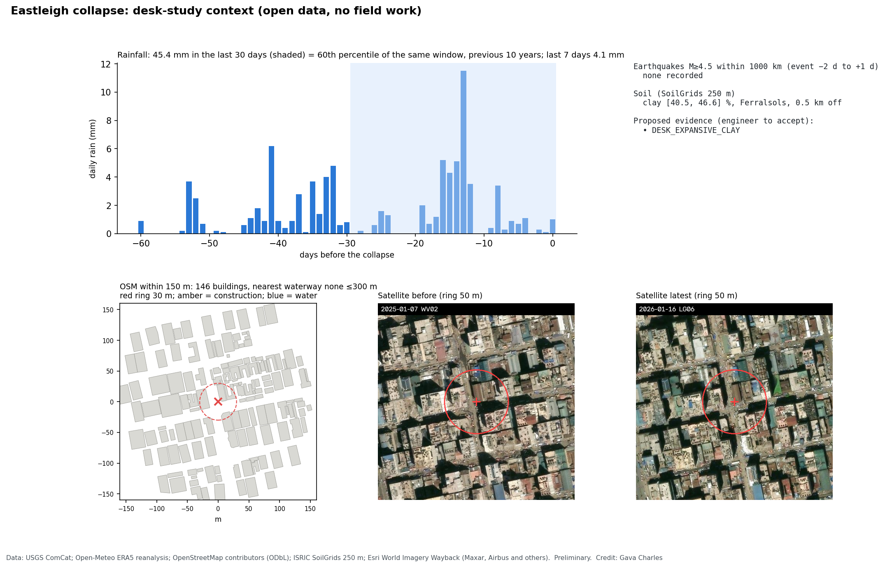
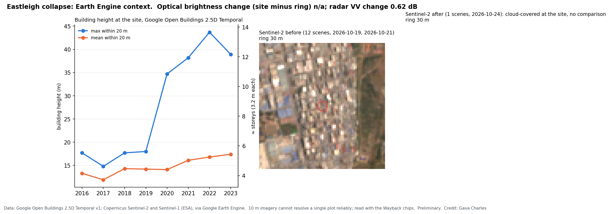
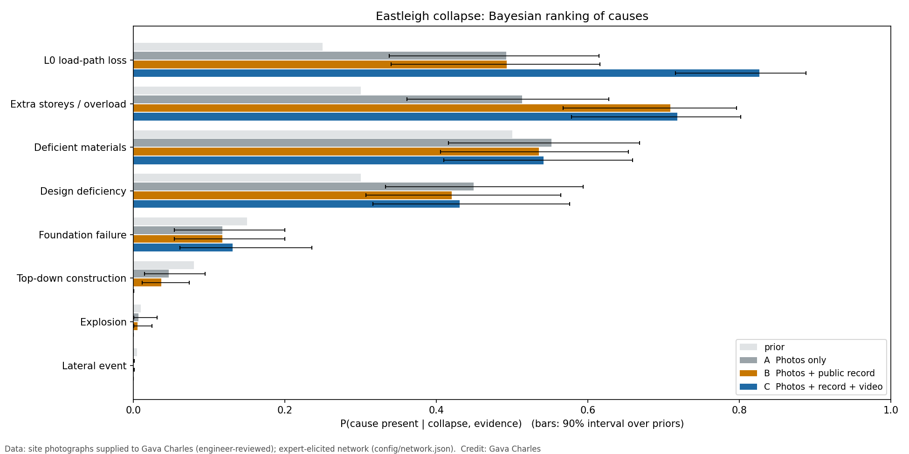
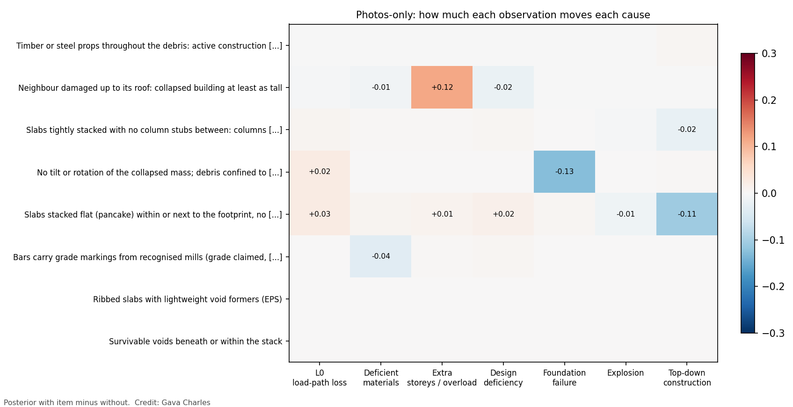
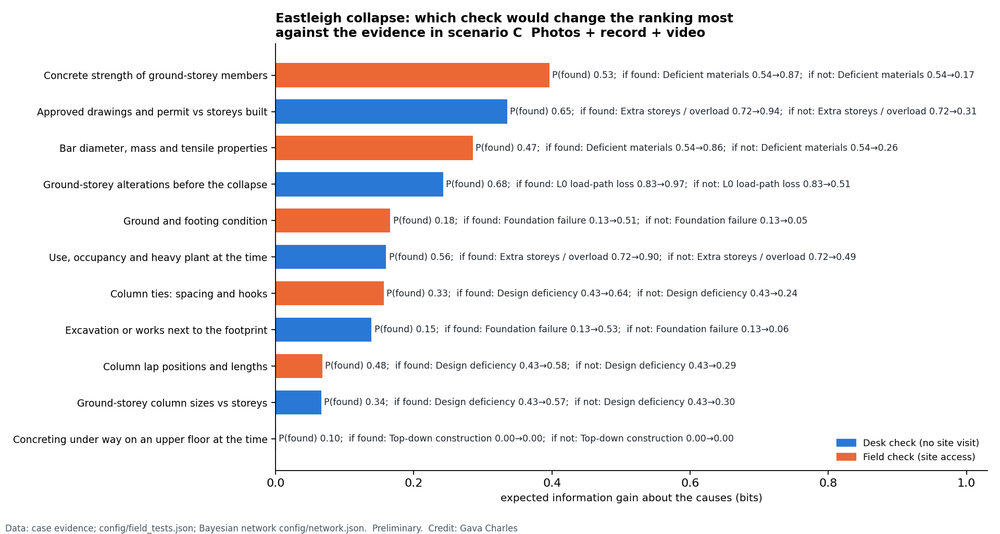

# Photo-based preliminary assessment: Eastleigh collapse

**Site:** LR No. 36/II/40, 9th Street, Eastleigh, Kamukunji Sub-County, Nairobi  
**Event:** 2026-10-23  
**Input:** 10 photographs (7 wide, 3 element); EXIF time/GPS: absent; 30 faces/plates blurred.  
**Status:** preliminary screening by an engineer, not a determination of cause.

## 1. Collapse mode

Vertical, progressive (pancake) collapse within the footprint: slabs stacked flat, no tilt or overturning. Consistent with loss of vertical support; inconsistent with overturning, lateral sway or a blast.

## 2. Evidence by theme

| Evidence item | Theme | Supporting photos |
|---|---|---|
| Timber or steel props throughout the debris: active construction with propped slabs | Construction stage and loading | 840733.jpg, 841317.jpg, 841321.jpg |
| Neighbour damaged up to its roof: collapsed building at least as tall | Neighbouring buildings and height | 841317.jpg, 841321.jpg, 841325.jpg, 841326.jpg |
| Slabs tightly stacked with no column stubs between: columns crushed or punched through over the full storey | How it came down | 841382.jpg |
| No tilt or rotation of the collapsed mass; debris confined to footprint and adjoining street | How it came down | 841322.jpg, 841323.jpg |
| Slabs stacked flat (pancake) within or next to the footprint, no overturning | How it came down | 841317.jpg, 841322.jpg |
| Bars carry grade markings from recognised mills (grade claimed, not verified) | Steel and concrete | 840733.jpg, 840734.jpg, 840735.jpg |
| Ribbed slabs with lightweight void formers (EPS) | Members and detailing | 841382.jpg |
| Survivable voids beneath or within the stack | Voids and rescue | 841322.jpg, 841382.jpg |

Shown but **not used in the ranking** (low confidence, needs verification): Open-textured, voided concrete fragment: possible honeycombing (unverified).

## 3. Measurements

- **slab layers auto count:** 7
- **slab layers auto count range:** [3, 9]
- **layer count photo:** 841382.jpg
- **building storeys min:** 11
- **not measurable:** Pile height/volume: needs 20+ overlapping photos or a drone survey (structure-from-motion). Bar diameters, tie spacing, cover: need a scale reference in element close-ups.

## 4. Desk-study context (open data)

- **Earthquakes (USGS, M≥4.5 within 1000 km):** none.
- **Rain (Open-Meteo ERA5):** 45.4 mm in the 30 days before (60th percentile of the previous 10 years); 4.1 mm in the last 7 days.
- **Surroundings (OSM):** nearest mapped waterway none within 300 m; 146 buildings within 150 m; 0 mapped construction sites.
- **Soil (SoilGrids):** clay [40.5, 46.6] % (0-5 cm, 30-60 cm), Ferralsols, 0.5 km from site.
- **Satellite archive (Esri Wayback):** 12 distinct acquisitions in `context/sat/`; inspect for construction progress and adjacent works.

Proposed from open data: DESK_EXPANSIVE_CLAY (clay [40.5, 46.6] %, WRB Ferralsols (0.5 km from site); high clay but Ferralsols is not usually expansive: accept only if local geology confirms swelling (black cotton) soil). Items enter the ranking only when listed in `case.json` → `desk_evidence`.

- **Building height at the site (Google Open Buildings 2.5D Temporal, max within 20 m):** 2016 17.7 m (~5.5 storeys), 2017 14.8 m (~4.6 storeys), 2018 17.7 m (~5.5 storeys), 2019 18.0 m (~5.6 storeys), 2020 34.7 m (~10.8 storeys), 2021 38.2 m (~12.0 storeys), 2022 43.7 m (~13.7 storeys), 2023 38.9 m (~12.2 storeys).
- **Before/after change at the site vs a 300 m ring (Sentinel-2 brightness; Sentinel-1 VV dB):** {'radar_vv_change_db': 0.62}.
- Proposed: DESK_RAPID_VERTICAL_GROWTH (plot height 14.8 m (2017) to 34.7 m (2020)).

## 5. Bayesian ranking of causes

| Cause | Prior | A  Photos only | B  Photos + public record | C  Photos + record + video |
|---|---|---|---|---|
| Deficient materials | 0.50 | 0.55 | 0.54 | 0.54 |
| Extra storeys / overload | 0.30 | 0.51 | 0.71 | 0.72 |
| L0 load-path loss | 0.25 | 0.49 | 0.49 | 0.83 |
| Design deficiency | 0.30 | 0.45 | 0.42 | 0.43 |
| Foundation failure | 0.15 | 0.12 | 0.12 | 0.13 |
| Top-down construction | 0.08 | 0.05 | 0.04 | 0.00 |
| Explosion | 0.01 | 0.01 | 0.01 | 0.00 |
| Lateral event | 0.01 | 0.00 | 0.00 | 0.00 |

## 6. What these photographs cannot establish (data gaps)

- Where failure started (ground storey vs upper floors): pancaked debris looks the same either way.
- Main bars undersized for the member, or smooth/re-rolled bars in primary members (needs: Bar diameter against a tape or caliper; deformations; marking absent).
- Friable concrete that crumbles by hand, weak aggregate, or low core/rebound results (needs: Fracture faces; hand-crushing; rebound hammer or cores).
- Column ties widely spaced (> ~200 mm) and/or 90-degree hooks that opened (needs: Column stub close-ups with tape: tie spacing, hook angle, opened ties).
- Ground-storey columns small for the number of storeys (needs: Column dimensions with tape; storey count).
- Ground-storey columns or walls cut, chased or removed (shopfronts, openings) (needs: Saw cuts, chased services, missing columns, fresh openings at L0).
- Recent excavation, basement or trench next to the footprint (needs: Open excavations, shoring, undermined footings).
- Ground cracking, heave, ponding or settled footings at the site (needs: Ground surface around footprint; exposed footings).

## 7. What to check next (value of information, against: C  Photos + record + video)

| # | Check | Access | P(found) | If found | If not found | Gain (bits) |
|---|---|---|---|---|---|---|
| 1 | Concrete strength of ground-storey members (Cores (BS EN 12504-1) or rebound hammer on surviving members and large debris) | field | 0.53 | Deficient materials 0.54→0.87 | Deficient materials 0.54→0.17 | 0.396 |
| 2 | Approved drawings and permit vs storeys built (County planning records, NCA registration, developer adverts, archive imagery storey count) | desk | 0.65 | Extra storeys / overload 0.72→0.94 | Extra storeys / overload 0.72→0.31 | 0.335 |
| 3 | Bar diameter, mass and tensile properties (Caliper and mass per metre on debris bars; tensile tests (KS EAS 412 / BS 4449)) | field | 0.47 | Deficient materials 0.54→0.86 | Deficient materials 0.54→0.26 | 0.286 |
| 4 | Ground-storey alterations before the collapse (Pre-collapse photos and videos (social media, Street View), tenant and worker interviews) | desk | 0.68 | L0 load-path loss 0.83→0.97 | L0 load-path loss 0.83→0.51 | 0.242 |
| 5 | Ground and footing condition (Trial pits at footings, boreholes, settlement survey of neighbours) | field | 0.18 | Foundation failure 0.13→0.51 | Foundation failure 0.13→0.05 | 0.166 |
| 6 | Use, occupancy and heavy plant at the time (Business permits, tenant interviews, social-media posts) | desk | 0.56 | Extra storeys / overload 0.72→0.90 | Extra storeys / overload 0.72→0.49 | 0.160 |
| 7 | Column ties: spacing and hooks (Tape survey of exposed column stubs and debris columns) | field | 0.33 | Design deficiency 0.43→0.64 | Design deficiency 0.43→0.24 | 0.157 |
| 8 | Excavation or works next to the footprint (Satellite chips from the context stage, neighbour permits, photos) | desk | 0.15 | Foundation failure 0.13→0.53 | Foundation failure 0.13→0.06 | 0.139 |
| 9 | Column lap positions and lengths (Exposed column stubs and debris columns) | field | 0.48 | Design deficiency 0.43→0.58 | Design deficiency 0.43→0.29 | 0.068 |
| 10 | Ground-storey column sizes vs storeys (Structural drawings if obtainable; otherwise tape survey of stubs on site) | desk | 0.34 | Design deficiency 0.43→0.57 | Design deficiency 0.43→0.30 | 0.066 |
| 11 | Concreting under way on an upper floor at the time (Contractor records, worker interviews, ready-mix delivery notes) | desk | 0.10 | Top-down construction 0.00→0.00 | Top-down construction 0.00→0.00 | 0.000 |

Desk checks need no site visit and can start now.

## 8. Method and reproducibility

Intake (inventory, SHA-256, perceptual-hash duplicate check, face blurring with YuNet plus reviewed manual boxes) → engineer-reviewed tagging against a fixed evidence library (`config/evidence_library.json`) → evidence plates and log → automatic measurements → exact Bayesian inference over a shared network (`config/network.json`), with 90 % intervals from Monte Carlo over priors and a one-at-a-time influence analysis → this report. Low-confidence observations are shown but excluded from inference. Every input, config and code file is hashed in `run_manifest.json`.

*Credit: Gava Charles. Data: site photographs supplied to Gava Charles.*